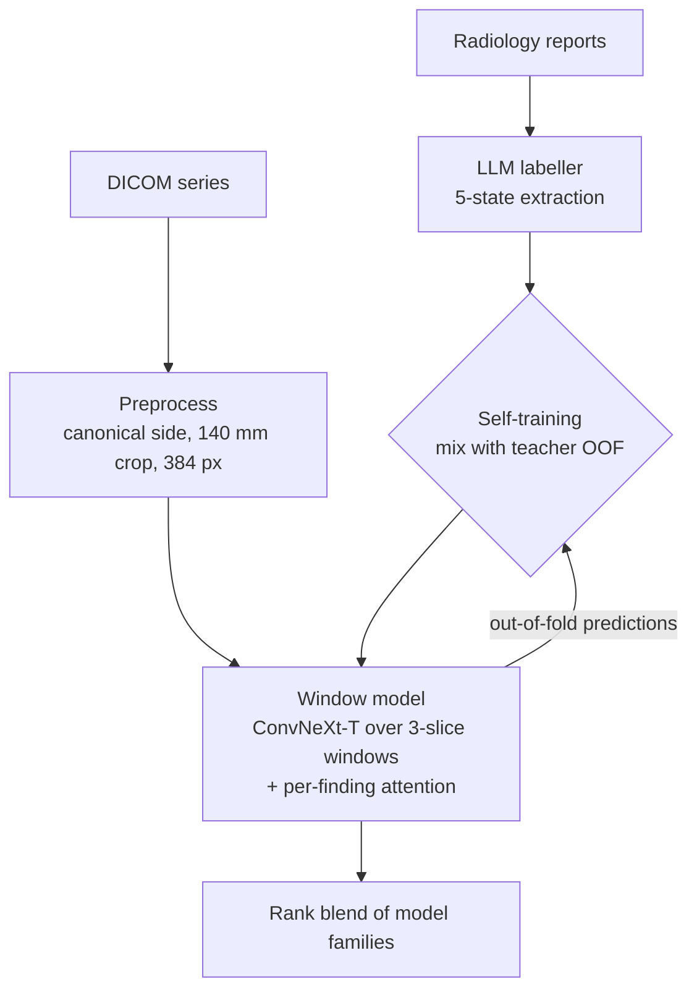

# RSNA Knee MRI Abnormality Detection

Multi-label detection of 12 knee abnormalities from MRI, for the
[RSNA Knee Abnormality Detection](https://www.kaggle.com/competitions/rsna-knee-abnormality-detection) Kaggle competition (Oct 2026).

**Private LB 0.940, public 0.951 (macro AUC).** All models are my own: no public notebooks or blends.


## Problem

Of 4,407 training studies, only 58 have radiologist image labels. The other 4,349 have a free-text report in one of 9 languages, and the test set has images only. Most of the work is weak supervision: turning reports into training targets for an image model.

## Approach



- **Labels:** an LLM extracts one of 5 states per finding from each report. Gold-58 AUC 0.872, total cost $8.68.
- **Self-training:** report labels are mixed with image-model out-of-fold predictions, with weights set per finding (+0.011 LB).
- **Model:** 2.5D ConvNeXt-Tiny over 3-slice windows from all views, with attention pooling per finding.
- **Blend:** rank average of model families trained on different labels.

Details: [docs/approach.md](docs/approach.md).

## Results

| Step | Public | Private |
|---|---|---|
| Baseline (EfficientNet-B0, LLM labels) | 0.924 | 0.911 |
| Self-training round 2 | 0.935 | 0.921 |
| Window ConvNeXt-T | 0.948 | 0.935 |
| Final rank blend | **0.951** | **0.940** |
| *1st place, for reference* | *0.967* | *0.958* |

## Layout

```
src/rsna_knee/   labeller, validation, preprocess, model, infer.py
kaggle/          Kaggle kernels (preprocess, train, inference, blend) and push scripts
tests/           unit tests
docs/            approach, experiments, decisions, learnings
```

## Run

```bash
uv sync
uv run pytest
```

Competition data goes in `data/raw/` and is not included. Pipeline commands are in [docs/approach.md](docs/approach.md#running-it).
