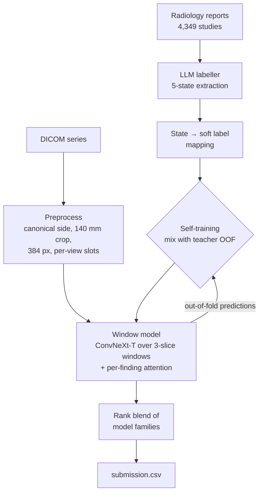

# Approach

Detailed description of the pipeline. The README has the short version.

## The problem

Each study is one patient's knee MRI: several DICOM series (sagittal, coronal and axial, with and without fat suppression), about 30 slices each. For each study the model outputs a probability for 12 findings:

| Group | Findings |
|---|---|
| Ligament tears | ACL, MCL |
| Meniscal tears | Medial meniscus, Lateral meniscus |
| Osteoarthritis | Medial, Lateral, Patellofemoral |
| Fluid / swelling | Effusion, Synovitis, Baker's cyst |
| Bone | Contusion, Acute fracture |

**The hard part is the labels.** Of 4,407 training studies, only **58** have image-based labels from radiologists. The other 4,349 come with only a free-text radiology report, in 9 languages. At test time there are images only. So the project is mainly about weak supervision: turning reports into training targets that agree with what radiologists see on the images.

## Approach



### 1. Report labeller ([`src/rsna_knee/labeller`](../src/rsna_knee/labeller))
- An LLM reads each report and returns one of five states per finding: `positive / uncertain / below_threshold / absent / not_addressed`, with a quoted evidence span. Output is strict JSON via the Batch API, with every answer cached on disk.
- **Why five states:** the labels are image-based with strict thresholds ("small effusion" counts as negative). For AUC, the ranking between "small effusion" and "no effusion" still matters, so mild findings get their own tier. This alone moved gold-dev AUC from **0.788 to 0.880**.
- The mapping from states to probabilities is fit on the dev half of the gold studies only.
- Final labeller: **0.872 macro AUC** on all 58 gold studies. Total API cost: **$8.68**.

### 2. Validation ([`src/rsna_knee/validation`](../src/rsna_knee/validation))
- No hospital column exists, so a **site proxy** (report language and template, 29 groups) stands in for it. Folds are grouped by site and stratified across all 12 labels with a greedy assignment that works for soft labels.
- The 58 gold studies are never trained on. They are split into dev (29, for tuning) and test (29, scored rarely).

### 3. Preprocessing ([`src/rsna_knee/preprocess`](../src/rsna_knee/preprocess))
- Picks one series per view slot: sag FS, cor FS, axial FS, sag non-FS, cor non-FS.
- **Canonical side:** left knees are mirrored into the right-knee layout. The sagittal stack runs lateral→medial for one side and medial→lateral for the other, so without this a slice-position embedding means opposite anatomy on the two sides. This was found in a review of error cases with an LLM agent prompted as an MSK radiologist ([`.claude/agents/radiologist.md`](../.claude/agents/radiologist.md)).
- Fixed physical crop (140 mm → 384 px, about 0.36 mm/px), evenly spaced slices per view (26/30/30/22/20), per-series intensity normalisation.

### 4. Window model ([`src/rsna_knee/model`](../src/rsna_knee/model))
- Each view is cut into **3-slice windows** fed to a 2D ImageNet backbone (ConvNeXt-Tiny), a 2.5D design.
- **Per-finding attention pooling** over all windows from all views: an ACL tear shows on 2 slices and osteoarthritis on many, so each finding gets its own attention. This is a form of multiple-instance learning.
- Masked BCE on soft labels, separate learning rates for backbone and head, an average of the final weights of the best 3 epochs, and 43 random windows per study in training with all 128 at test.

### 5. Self-training
Report labels and image-model predictions make *different* errors. On gold-dev, report labels alone score 0.885, image predictions alone 0.916, and a 50/50 mix **0.933**. Each round re-labels the training set with the current models' out-of-fold predictions, using per-finding weights: 0.5 for tears, OA and synovitis, 0.1 for effusion, cyst, contusion and fracture. A stronger teacher is used each round.

### 6. Blending ([`kaggle/blend`](../kaggle/blend))
The metric only cares about ranking, so families are **rank-averaged**. Members are only added if they correlate clearly below 0.99 with the current blend.


## Running it

Requires Python 3.12 and [uv](https://docs.astral.sh/uv/). Competition data goes in `data/raw/` (not included; redistribution is against the competition rules).

```bash
uv sync
uv run pytest
```

```bash
# 1. labels from reports (needs OPENAI_API_KEY in .env)
uv run python -m rsna_knee.labeller.run gold --split dev
uv run python -m rsna_knee.labeller.run batch
uv run python -m rsna_knee.labeller.run export

# 2. validation splits
uv run python -m rsna_knee.validation.sites
uv run python -m rsna_knee.validation.gold_split
uv run python -m rsna_knee.validation.folds

# 3. preprocess and train one fold (or --fold -1 for all data)
uv run python -m rsna_knee.preprocess.run --series-csv data/raw/train_series.csv \
    --image-root data/raw/train_series --out data/processed/train
uv run python -m rsna_knee.model.train_windows --fold 0 --processed data/processed/train --out runs/window

# 4. inference
uv run python -m rsna_knee.infer --comp-dir data/raw --models runs/window --work /tmp/test --out submission.csv
```

Training ran on one GPU per job (~8 min per fold epoch). Inference runs offline in a Kaggle notebook on 2×T4.

